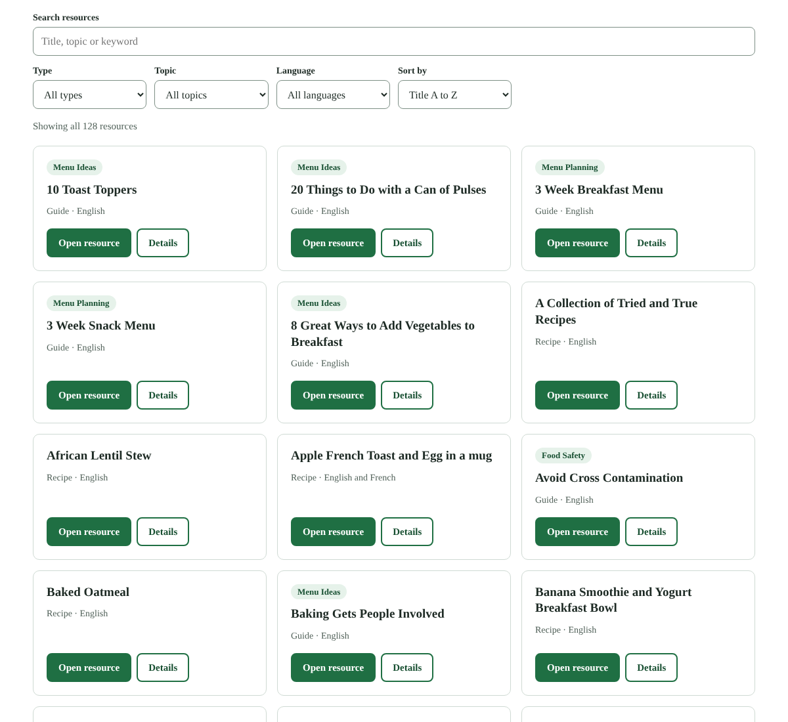

# CNCM site kit

Ready-to-paste modules, data and tests for the Child Nutrition Council of Manitoba (CNCM) website, which runs on Squarespace.

Staff never touch this repository. They paste one file into a Squarespace Code Block once, then edit content in a list or a Google Sheet. This repository is where the code is versioned, tested and rebuilt.



## What is in it

| Module | Paste-in file | What it does |
| --- | --- | --- |
| Webinar library | `dist/webinar-library.html` | Searchable, filterable list of CNCM webinars (9 today) |
| Resource library | `dist/resource-hub.html` | The whole Resource Hub (128 items) in one searchable list: guides, recipes, webinars |
| Impact by region | `dist/impact.html` | Headline numbers with sources, schools supported by region, searchable division table |

Every module:
- works inside the existing Squarespace site, with no new software, accounts or tracking;
- finds words without accents ("education" finds "Éducation") and switches to French labels on French pages;
- keeps filters in the address bar, so a filtered view can be shared as a link;
- falls back to a plain link if JavaScript is blocked, and to its built-in data if a Google Sheet fails;
- passes an automated accessibility scan (axe) and keyboard, phone-width and aggressive-theme tests.

## Concept website

`sandbox/site/` is a clickable concept of a complete CNCM site built around these modules: https://mr-jess-s.github.io/cncm-site-kit/site/ . Pages live in `site/pages/`, styles in `site/site.css`; `python3 tools/build.py` rebuilds everything. Every page says it is a concept and is hidden from search engines.

## Quick start

```bash
npm install                 # once
npm test                    # build, then run all 52 browser tests
npm run sandbox             # build, then open http://localhost:4173 to try every module
```

Refresh the Resource Hub data from the live site (needs internet access to childnutritioncouncil.com):

```bash
python3 tools/squarespace_to_csv.py --fetch && npm run build
```

## How it is put together

```
modules/        source code: one folder per module (CSS + JavaScript)
instances/      one settings file per paste-in (which data, which wording, which filters)
data/           the content, as CSV: resources, divisions, impact numbers, manual overrides
data/source/    the raw Squarespace export the resource list was built from
tools/          build.py (makes dist/ and sandbox/), squarespace_to_csv.py (imports the Resource Hub)
dist/           the paste-in files. Built, committed, never edited by hand
sandbox/        test pages for every module: plain, French, aggressive theme
tests/          Playwright browser tests, including axe accessibility scans
monitor/        weekly site monitor (passive checks) and its tests
docs/           staff guide, test environment, screenshots
content/        ready-to-use copy for pages (for example refreshed Local Impact statistics)
```

The same library module powers both the webinar list and the Resource Hub; an instance file decides which rows to show (`"include": {"type": "Webinar"}`) and what the labels say. Adding a new list is a new instance file, not new code.

## Proven parts, not custom inventions

| Need | Chosen | Why |
| --- | --- | --- |
| Website platform | Squarespace (CNCM's existing site) | No migration; hosting, security and backups handled by the platform; staff already use it |
| Content editing | CSV in the Code Block, or a Google Sheet published as CSV | Spreadsheets are the tool staff already know; no database to run |
| Browser testing | Playwright | Widely used, maintained by Microsoft, runs the same locally and in GitHub Actions |
| Accessibility testing | axe-core (Deque) through `@axe-core/playwright` | Industry-standard automated WCAG checks |
| Continuous testing and test site | GitHub Actions and GitHub Pages | Free for public repositories, versioned history of every change |
| Interface patterns | Search box plus filters, "Show more", shareable filtered links, labelled form fields, live result counts | Long-established patterns for searchable catalogues |

The modules themselves have no third-party runtime libraries, so nothing can break when someone else's code changes.

## Versions and changes

- `VERSION` holds the kit version; every paste-in file states the version it was built from.
- Record changes in `CHANGELOG.md`; tag releases (`git tag v1.0.0`).
- Pull requests run the full test suite automatically; do not merge a red build.
- To roll back a module on the live site, paste the `dist/` file from the previous tag.

## Known limits

- Squarespace runs scripts in Code Blocks on Core plans and higher. CNCM's plan is not yet confirmed.
- Squarespace's maximum Code Block size is not documented that we could find. `resource-hub.html` is about 60 KB; if Squarespace refuses it, use Google Sheet mode, which keeps the data out of the block.
- Squarespace has no built-in multilingual feature; French pages need duplicate pages or an add-on.
- Division figures are as printed on CNCM's Local Impact page, including its marked inconsistencies.

More: [changes/](changes/README.md) (approved change tickets) · [docs/AGENTS.md](docs/AGENTS.md) (site overseer and webmaster agents) · [docs/STAFF-GUIDE.md](docs/STAFF-GUIDE.md) · [docs/TEST-ENVIRONMENT.md](docs/TEST-ENVIRONMENT.md) · [content/local-impact-refresh.md](content/local-impact-refresh.md)
